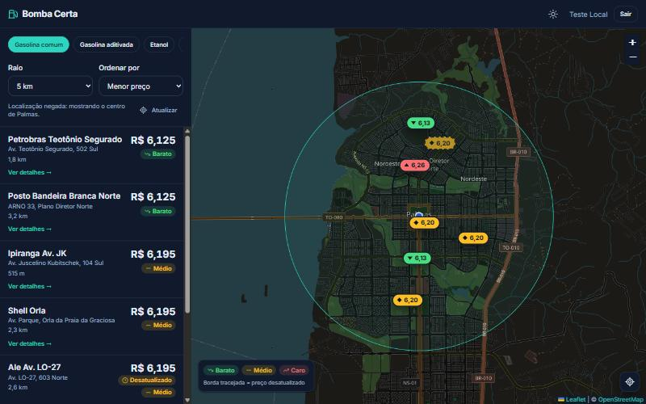
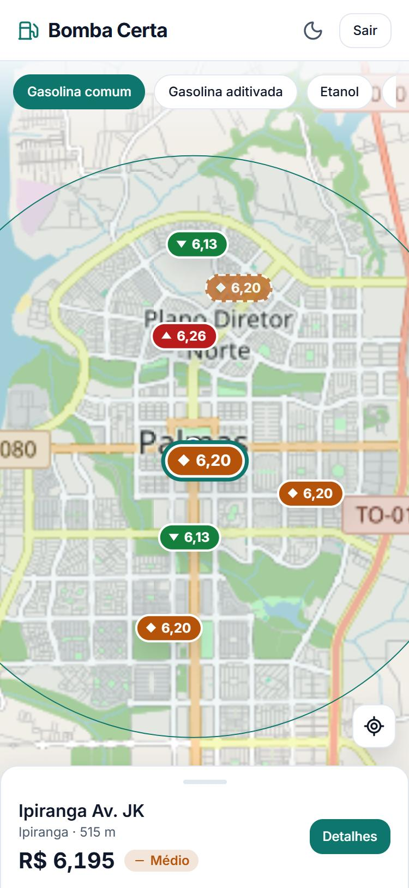
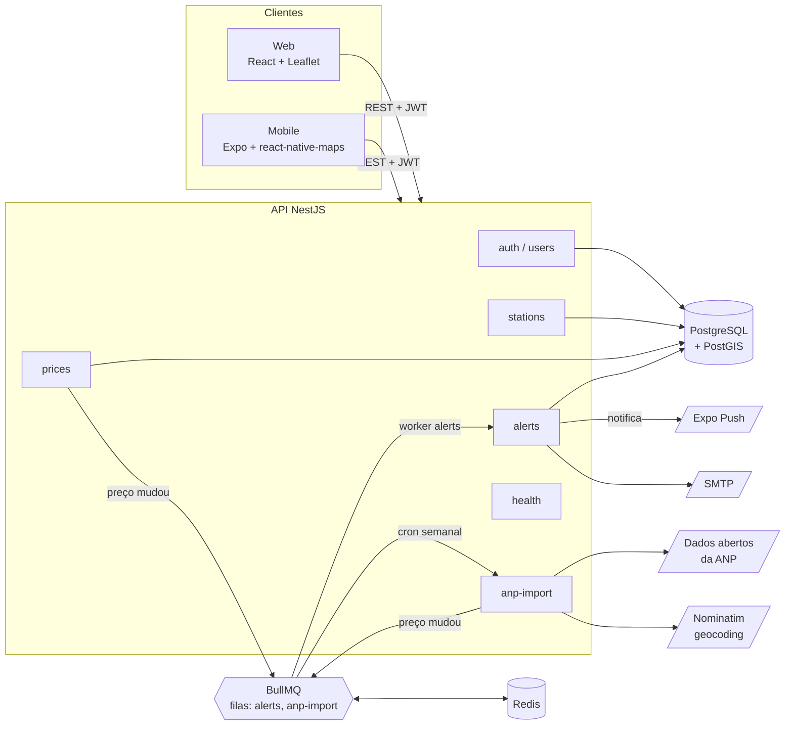

# ⛽ Bomba Certa

Mapa colaborativo de preços de combustível em **Palmas-TO**. Usuários reportam o preço nos postos, o app
mostra o mais barato perto de você e o histórico de cada posto. Uma importação semanal dos dados abertos da ANP
garante dados mesmo sem usuários, e alertas de preço avisam quando algum posto no seu raio ficar abaixo do valor que você definiu.

> Projeto de portfólio full stack, do banco ao deploy. Nome provisório.

|                                      Mapa (tema claro)                                       |                       Mapa (tema escuro)                        |
| :------------------------------------------------------------------------------------------: | :-------------------------------------------------------------: |
|  |  |

|                                  Posto, histórico e reporte                                   |                                 Celular: bottom sheet                                  |
| :-------------------------------------------------------------------------------------------: | :------------------------------------------------------------------------------------: |
|  |  |

> Os preços e a maioria dos postos das imagens são **fictícios** (seed de desenvolvimento).
> O app Expo ainda não foi executado em aparelho neste repositório: o print mobile acima é o web em viewport de celular.

## Funcionalidades

- **Cadastro e login** com JWT de acesso curto + _refresh token_ rotativo com detecção de reuso
- **Postos** com localização (`geography(Point, 4326)`), bandeira e endereço
- **Reporte de preço** por combustível (gasolina comum, aditivada, etanol, diesel S10)
- **Busca por raio** com `ST_DWithin`, ordenada por preço ou distância, paginada
- **Mapa** com pinos por faixa de preço (barato, médio, caro) que usam **forma além da cor** (▼ ◆ ▲), _clustering_ que mostra a quantidade e o preço mais barato do grupo, e destaque para preço desatualizado
- **Página do posto** com histórico de preços (Recharts)
- **Tema claro e escuro**, _bottom sheet_ no celular, estados de carregamento (skeleton), erro (com "tentar novamente") e vazio, e toasts
- **Importação semanal da ANP** por job agendado no BullMQ, filtrada por Palmas
- **Alertas de preço** processados em fila, com notificação in-app, e-mail e push (Expo). No web: página **Alertas** (criar, listar, excluir com "desfazer"), caixa de notificações e um **sino** no cabeçalho com contagem de não lidas e toast quando um alerta dispara
- **Confirmação de reportes** com o botão só para quem pode usá-lo: a API informa `isMine` e `confirmedByMe` (autenticação opcional; o id do autor nunca é exposto)
- **Mobile (Expo)** com mapa, reporte rápido, alertas e push notifications

### Regras de negócio

| Regra                                                                                              | Como é feita                                                                                        |
| -------------------------------------------------------------------------------------------------- | --------------------------------------------------------------------------------------------------- |
| O preço exibido é o reporte mais recente com no máximo 7 dias; mais antigo aparece "desatualizado" | `station_current_prices` + flag `stale` calculada na resposta                                       |
| Reporte fora da faixa plausível fica pendente                                                      | Mediana da cidade ±15% (configurável), referência da **ANP** primeiro; fora da faixa vira `PENDING` |
| Outros usuários podem confirmar; confirmados têm mais peso                                         | 2 confirmações de usuários diferentes (nunca o autor) ativam o reporte                              |
| Um reporte por usuário, posto e combustível a cada 6 horas                                         | Checagem no serviço sobre índice `(user, posto, combustível, data)`; responde 429                   |
| Dados da ANP e dos usuários marcados com a origem                                                  | Enum `PriceSource` (`USER` \| `ANP`) em postos e reportes                                           |

## Arquitetura



Monorepo **pnpm workspaces**:

```
apps/
  api/        NestJS 11 · Prisma · PostgreSQL/PostGIS · BullMQ · Swagger
  web/        React 19 · Vite · Tailwind 4 · TanStack Query · Leaflet + markercluster · Recharts
  mobile/     Expo SDK 58 · expo-router · react-native-maps · expo-notifications
packages/
  shared/     Schemas Zod, tipos da API, formatadores e faixas de preço (usado por todos)
```

## Como rodar localmente

Pré-requisitos: **Node 22+**, **pnpm 11** (`corepack enable`) e **Docker**.

```powershell
pnpm install
Copy-Item .env.example .env
Copy-Item .env.example apps/api/.env
docker compose up -d            # PostGIS, Redis e Mailpit
pnpm --filter @bomba-certa/shared build
pnpm --filter @bomba-certa/api prisma:deploy
pnpm --filter @bomba-certa/api seed     # 12 postos de Palmas com preços fictícios
```

Defina `JWT_ACCESS_SECRET` (32+ caracteres) no `.env` e no `apps/api/.env`. Depois, em dois terminais:

```powershell
pnpm --filter @bomba-certa/api start:dev   # API em http://localhost:3000  (Swagger em /docs)
pnpm --filter @bomba-certa/web dev         # Web em http://localhost:5173
```

Portas do Docker Compose: PostgreSQL **5440** (evita conflito com um Postgres local), Redis 6379, Mailpit UI 8026.
Para o app mobile, veja [apps/mobile/README.md](apps/mobile/README.md).

### Testes e qualidade

```powershell
pnpm lint
pnpm format:check
pnpm typecheck
pnpm --filter @bomba-certa/shared test      # 9
pnpm --filter @bomba-certa/api test         # 34 unitários
pnpm --filter @bomba-certa/api test:e2e     # 24, contra PostgreSQL/PostGIS e Redis reais
pnpm --filter @bomba-certa/web test         # 41
pnpm --filter @bomba-certa/mobile test      # 5
```

O GitHub Actions ([ci.yml](.github/workflows/ci.yml)) roda lint, formatação, typecheck, todos os testes (com serviços
`postgis/postgis` e Redis), o build do web, o bundle do mobile e o build da imagem Docker.

## Decisões técnicas

**Geoespacial**

- Coluna `geography(Point, 4326)` com índice **GIST**. A busca usa `ST_DWithin(location, ponto, metros)`, que usa o
  índice (um `ST_Distance(...) < r` no `WHERE` não usaria) e devolve distâncias em metros pelo esferoide.
- `ST_MakePoint(lng, lat)`: x vem antes de y, o oposto de como se fala "lat, lng". Isso está comentado onde importa.
- O Prisma não lê `geography`: o campo é `Unsupported(...)` e as consultas espaciais são `$queryRaw`. O índice GIST sai na
  migration; os índices parciais ficam em SQL manual (o Prisma os ignora sem gerar _drift_).
- Alertas guardam o **centro** do alerta como `geography`: um preço novo é cruzado com todos os alertas por
  `ST_DWithin(alerta.centro, posto.localizacao, alerta.raio)` numa só consulta indexada.

**Dados**

- Preço em **inteiro de milésimos** (R$ 5,899 → `5899`): sem erro de ponto flutuante.
- `station_current_prices` **denormalizada**: a busca por raio ordenada por preço faz um `JOIN`, em vez de um
  `DISTINCT ON` sobre todo o histórico. É atualizada com um único `INSERT … ON CONFLICT … WHERE reported_at <= …`,
  atômico, para que um reporte antigo ativado tarde ou uma linha da ANP nunca sobrescrevam um preço mais novo.
- Importação da ANP **idempotente** por índice único parcial `(posto, combustível, data) WHERE source = 'ANP'`.
- Referência de plausibilidade pela **mediana** (resistente a um valor absurdo) e priorizando a **ANP**, para que um grupo
  de reportes falsos não desloque a referência. Com poucas amostras, nada é julgado.

**Autenticação**

- _Refresh token_ opaco, guardado só como **hash**, de uso único e rotativo. Reapresentar um token já usado revoga a
  família inteira (sinal de roubo). A rotação é um `UPDATE … WHERE revoked_at IS NULL`, então só uma requisição concorrente vence.
- Mesma mensagem para e-mail inexistente e senha errada. _Rate limit_ mais rígido nas rotas de auth.
- No web os tokens ficam no `localStorage` (simples, mas expostos a XSS; a evolução é um cookie `httpOnly`).
  No mobile, no Keychain/Keystore (`expo-secure-store`).

**Filas (BullMQ)**

- _Claim-then-notify_: o `UPDATE … WHERE last_notified_at IS NULL` é o trava. Dois workers (ou um retry) nunca notificam
  duas vezes; se a entrega falha, a trava é liberada e o job tenta de novo.
- Alerta **rearma** sozinho quando nenhum posto no raio está no alvo ou abaixo (sem spam enquanto o preço fica baixo).
- Sem `jobId` por posto: deduplicar descartaria um evento que chega durante um job ativo, que já leu o preço antigo. Os jobs
  são idempotentes, então jobs a mais são inofensivos. (O BullMQ também proíbe `:` em `jobId`; um e2e pegou isso.)
- O agendamento semanal (`upsertJobScheduler`) é idempotente e **se recria a cada hora**, porque um Redis efêmero pode esquecê-lo.
- O in-app é a fonte da verdade (falha → retry); e-mail e push são _best effort_ atrás da interface `NotificationChannel`.

**Front-end (web)**

- **Design tokens** em CSS (`--background`, `--primary`, `--band-cheap`...) mapeados com `@theme inline` do Tailwind 4: os componentes só
  usam nomes semânticos, então o tema escuro é só outro conjunto de valores (classe `.dark`, com script inline que evita o _flash_).
- **Atomic Design** (`atoms/molecules/organisms/templates`), variantes com `class-variance-authority` e `tailwind-merge`.
- **Acessibilidade**: a faixa de preço nunca depende só da cor (ícone + texto na lista, forma no pino); `aria-pressed` nos filtros,
  `aria-expanded` e `inert` no _bottom sheet_, foco visível, _skip link_ e respeito a `prefers-reduced-motion` (inclusive no gráfico).
- **Mapa com a API nativa do Leaflet**, não `react-leaflet`: o `leaflet.markercluster` não tem wrapper React, e criar/destruir o mapa em
  efeitos mantém seguro o duplo _mount_ do StrictMode. Os ícones são HTML gerado por funções puras e testadas (`lib/mapIcons.ts`).
  O tema escuro do mapa inverte os tiles por CSS, sem um segundo provedor.
- **`AsyncStateView`**: um só lugar para os quatro estados de dado remoto (carregando, erro com retry, vazio, sucesso).
- _Bottom sheet_ com altura **medida** (`ResizeObserver`), para a bandeja recolhida caber exatamente no conteúdo.

**Qualidade**

- Zod como **fonte única**: os mesmos schemas validam a API (`nestjs-zod`, que também gera o Swagger), o web e o mobile.
- Testes de integração contra **PostGIS e Redis reais**, não mocks: as consultas espaciais e as filas são justamente o que dá errado.
  Isso pegou falhas reais (por exemplo, `jobId` com `:` proibido pelo BullMQ, que derrubava os alertas em silêncio).
- Variáveis de ambiente validadas no boot (a aplicação se recusa a subir com ambiente inválido), logs estruturados com `pino`
  (cabeçalho `Authorization` mascarado), filtro global de erros e paginação.
- O seed recusa rodar contra banco remoto sem confirmação explícita.

## Deploy

Gratuito: **Render** (API + Redis) + **Neon** (PostgreSQL com PostGIS) + **Cloudflare Pages** (web). O repositório está pronto
(Dockerfile, [render.yaml](render.yaml), keep-alive), **mas nada foi publicado**. Passo a passo e limitações em [DEPLOY.md](DEPLOY.md).

## Limitações conhecidas e próximos passos

- **ANP**: o link e o formato do arquivo semanal atual **não foram confirmados**; o parser segue o dicionário de dados oficial
  e foi testado com um arquivo fictício. Também não confirmei se Palmas está na amostra de municípios pesquisados.
  Postos cadastrados por usuários sem CNPJ não casam com a ANP.
- **Mobile**: validado por typecheck, testes e _bundle_ do Metro, **não** em aparelho. Push exige projeto EAS e _development build_.
- Eventos de preço são publicados após o _commit_ (_best effort_): se o Redis cair, o preço é salvo mas o alerta atrasa. Um _outbox_ transacional resolveria.
- O mobile ainda não tem a lista de reportes pendentes (só o web), e o sino do web atualiza por _polling_ de 1 min (mais um _refetch_ logo após criar um alerta), não em tempo real: um WebSocket/SSE seria a evolução.
- Sem administração/moderação além das confirmações entre usuários.
- No plano gratuito do Render a API hiberna (ver [DEPLOY.md](DEPLOY.md#limitações-do-plano-gratuito)).
